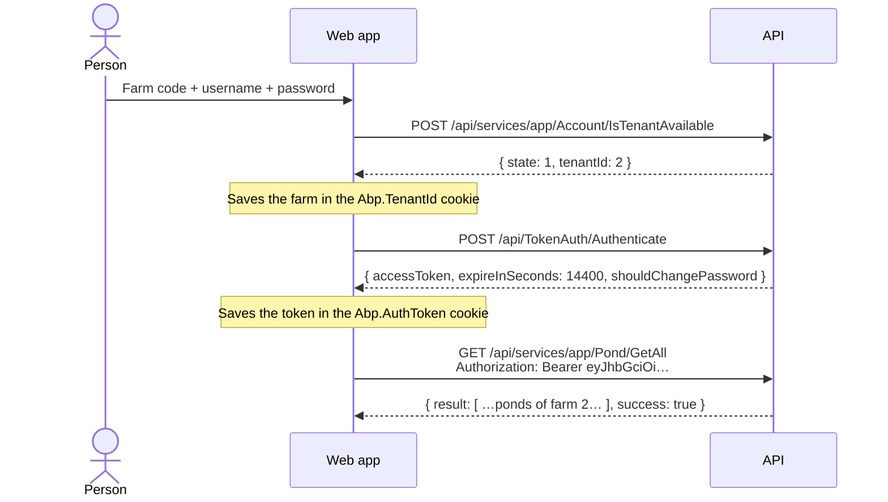

# API and keys

> **Development copy.** Written for release 1.0.0 in `znuluf/try-prod`; this development project works the same way,
> except that its database migrations are generated in each Codespace instead of committed, and read-committed snapshot
> is set by `.devcontainer/start-fpms.sh` rather than by the migration `DatabaseSettings`.

How the web app talks to the server, how a person proves who they are, which endpoints exist and who may call them, and
every key, password and secret the system uses: what it is for, where it is set and how to change it.

See also: [How FPMS works](system-overview.md) for the big picture, [Database queries](database-queries.md) for what
each call does in the database.

> **Short answer about "API keys":** FPMS uses **no third-party API and no API keys**. It runs on the farm PC without
> Internet. The only "keys" are the system's own secrets (section 6): the token signing key, the database password, the
> first System Administrator password, the HTTPS certificate password and the off-site backup passphrase. People never
> get a key; they sign in and receive a short-lived access token (section 2).

---

## 1. The shape of every call

All endpoints live under one address and follow one pattern:

```
https://<farm-server>:44311/api/services/app/{Service}/{Method}
```

| Part | Example | Rule |
|---|---|---|
| Service | `Feeding` | The application service class name without `AppService` (`FeedingAppService`) |
| Method | `SaveSheet` | The public method name |
| HTTP verb | `POST` | ABP's convention: methods starting with `Get` are **GET** (inputs in the query string), `Update` is **PUT**, `Delete` is **DELETE**, everything else is **POST** (inputs as a JSON body) |

Every answer is wrapped in the same envelope, also for errors:

```json
{
  "result": { "id": "4c1f…", "lotCode": "GSC-24-01-03-2611" },
  "success": true,
  "error": null,
  "unAuthorizedRequest": false,
  "__abp": true
}
```

A refused save comes back with `success: false` and a message written for the person, never a stack trace:

```json
{
  "result": null,
  "success": false,
  "error": {
    "code": 0,
    "message": "This record was changed by someone else. Refresh the page and try again.",
    "details": null,
    "validationErrors": null
  },
  "unAuthorizedRequest": false,
  "__abp": true
}
```

| HTTP status | Meaning |
|---|---|
| 200 | Done (`success: true`) |
| 400 | The input failed validation (a missing field, a number out of range); `validationErrors` lists the fields |
| 401 | Not signed in, or the sign-in ended (4 hours) |
| 403 | Signed in, but the role does not have the permission |
| 404 | The record does not exist |
| 500 | Either a **business rule refused it** (the batch is closed, the grade has no kilograms left, the record changed): `error.message` is written for the person; or an **unexpected error**: the message is ABP's generic "An internal error occurred during your request!" and the detail is only in the server log |

A record of another farm answers exactly like a missing record, so nobody can learn what another farm has.

Where in the code: ABP builds these endpoints from the application services (`aspnet-core/src/Capstone.Application/`);
the web app's client is `angular/src/shared/fpms/api.service.ts`.

---

## 2. Signing in and the access token



**Step 1, the farm.** `POST /api/services/app/Account/IsTenantAvailable` with `{"tenancyName": "rkabubba-aqua"}`
returns the farm's internal ID. An empty farm code means the System Administrator (host) signs in.

**Step 2, the password.** `POST /api/TokenAuth/Authenticate`, sent with the farm header `Abp.TenantId: 2`:

```json
{ "userNameOrEmailAddress": "konacsus", "password": "…" }
```

Answer:

```json
{
  "result": {
    "accessToken": "eyJhbGciOiJIUzI1NiIsInR5cCI6IkpXVCJ9…",
    "encryptedAccessToken": "…",
    "expireInSeconds": 14400,
    "userId": 4,
    "shouldChangePassword": false
  },
  "success": true
}
```

**Step 3, every later call** sends `Authorization: Bearer <accessToken>`. The web app's interceptor adds it, with the
farm header and the language, to every request.

### What is inside the token

The access token is a **JWT** (JSON Web Token): three Base64 parts, `header.payload.signature`. The payload carries
claims such as:

| Claim | Meaning |
|---|---|
| `sub`, `nameidentifier` | The user's ID |
| `http://www.aspnetboilerplate.com/identity/claims/tenantId` | The farm's ID. **The server takes the farm from here, never from the request.** |
| `role` | FarmOwner, FarmTechnician or SystemAdministrator |
| `AspNet.Identity.SecurityStamp` | Changes when the password is reset or the account deactivated, which signs the person out within a minute |
| `exp` | Expiry: 4 hours after sign-in (DEC-37) |
| `fpms_pwd_change_required` | Present until a temporary password is changed; such a token reaches only the change-password endpoint |

The signature is made with the server's **signing key** (section 6). Anyone can read a token, but nobody can change one
or make a new one without that key. Tokens are not stored on the server; signing out simply deletes the cookie.

| Rule | Where |
|---|---|
| 4-hour lifetime | `Authentication:JwtBearer:ExpirationMinutes` (default 240), `CapstoneWebCoreModule.cs` |
| Signature, issuer and audience checked on every call | `Capstone.Web.Host/Startup/AuthConfigurer.cs` |
| Security stamp checked on every call | `Capstone.Web.Core/Authentication/JwtBearer/JwtSecurityStampCheck.cs`, `Capstone.Core/Identity/SecurityStampValidator.cs` |
| Five wrong passwords lock the account for 15 minutes | ABP user lockout (`DefaultSettingsCreator.cs`); the System Administrator can unlock (`AccountRecovery.Unlock`) |
| Temporary password must be changed first | `PasswordChangeRequiredFilter`, `TokenAuthController` |

---

## 3. Trying the API yourself

In development, **Swagger** (`https://<api>/swagger`) lists every endpoint with its inputs and lets you call them. It is
switched off on the farm server (DEC-44). From a terminal:

```bash
API=https://localhost:44311
TENANT=$(curl -sk -X POST "$API/api/services/app/Account/IsTenantAvailable" -H 'Content-Type: application/json' -d '{"tenancyName":"rkabubba-aqua"}' | jq .result.tenantId)
```

```bash
TOKEN=$(curl -sk -X POST "$API/api/TokenAuth/Authenticate" -H 'Content-Type: application/json' -H "Abp.TenantId: $TENANT" -d '{"userNameOrEmailAddress":"arkabubba","password":"<password>"}' | jq -r .result.accessToken)
```

```bash
curl -sk "$API/api/services/app/Pond/GetAll" -H "Authorization: Bearer $TOKEN" | jq '.result[] | {pondCode, status}'
```

The sample farms' accounts and passwords are in [dev-accounts.md](dev-accounts.md). `GET /health` (no sign-in) answers
`Healthy` when the API can reach the database.

---

## 4. Every endpoint

36 services. "Who can call it" is the permission needed for the whole service; a method with a permission in brackets
needs that one as well. Generated from `aspnet-core/src/Capstone.Application/` (paths below are relative to it).

| Service (URL part) | Who can call it | Methods: HTTP verb and name (extra permission) | Code |
|---|---|---|---|
| `ActivityLog` | `Farm.ActivityLog` | GET GetActions; GET GetDataChanges; GET GetRecordTypes | `ActivityLogs/ActivityLogAppService.cs` |
| `Notification` | `Farm.Dashboard` | GET GetMine; GET GetUnreadCount; POST MarkRead; POST MarkAllRead | `Alerts/NotificationAppService.cs` |
| `Account` | anyone (farm code check, farm registration when switched on) | POST IsTenantAvailable; GET GetRegistrationStatus; GET GetRegistrationSuggestions; POST RegisterFarm | `Authorization/Accounts/AccountAppService.cs` |
| `Compliance` | `Farm.Compliance` | GET GetCategories; POST SaveCategory; POST SavePreset; GET GetDocuments; GET GetDocument; POST CreateDocument; PUT UpdateDocument; POST RenewDocument; POST SetArchived; GET GetStatus | `Compliance/ComplianceAppService.cs` |
| `Configuration` | any signed-in person | POST ChangeUiTheme | `Configuration/ConfigurationAppService.cs` |
| `Dashboard` | `Farm.Dashboard` | GET Get | `Dashboard/DashboardAppService.cs` |
| `FarmProfile` | `Farm.Profile` | GET Get; GET GetFarmCodeAvailability (`Farm.Profile.Edit`); POST ChangeFarmCode (`Farm.Profile.Edit`); PUT Update (`Farm.Profile.Edit`) | `Farms/FarmProfileAppService.cs` |
| `FarmUser` | `Farm.Users` | GET GetAll; GET GetSuggestedUserName; POST Create; PUT Update; POST SetActive; POST ResetPassword | `Farms/FarmUserAppService.cs` |
| `ContainerType` | `Farm.Harvests` | GET GetAll; POST Save (`Farm.Harvests.EditAny`) | `Harvests/ContainerTypeAppService.cs` |
| `Harvest` | `Farm.Harvests` | GET GetTypeCounts; GET GetSaleStatusCounts; GET GetList; GET Get; GET GetGradeOptions; POST Create (`Farm.Harvests.Create`); PUT Update (`Farm.Harvests.Create`) | `Harvests/HarvestAppService.cs` |
| `SizeGrade` | `Farm.Harvests` | GET GetAll; POST Save (`Farm.Harvests.EditAny`) | `Harvests/SizeGradeAppService.cs` |
| `SystemHealth` | `System.Health` | GET GetHealth; GET GetBackupRuns | `Health/SystemHealthAppService.cs` |
| `HealthBanner` | any signed-in person | GET Get | `Health/SystemHealthAppService.cs` |
| `Inventory` | `Farm.Inventory` | GET GetItems; POST SaveItem (`Farm.Inventory.Manage`); POST SetItemActive (`Farm.Inventory.Manage`); GET GetLots; GET GetLotOptions; POST RecordReceipt (`Farm.Inventory.Manage`); POST RecordAdjustment (`Farm.Inventory.Manage`); POST ClearReconciliationFlag (`Farm.Inventory.Manage`); GET GetMovements | `Inventory/InventoryAppService.cs` |
| `Feeding` | `Farm.Logs` | GET GetList; GET GetSheet; POST Save (`Farm.Logs.Create`); GET GetDailyStatus; POST SaveSheet (`Farm.Logs.Create`); POST Void (`Farm.Logs.EditAny`) | `Logbooks/FeedingAppService.cs` |
| `Log` | `Farm.Logs` | GET GetParameters; GET GetList; GET GetTypeCounts; GET Get; POST Create (`Farm.Logs.Create`); PUT Update (`Farm.Logs.Create`); POST Void (`Farm.Logs.EditAny`) | `Logbooks/LogAppService.cs` |
| `Pond` | `Farm.Ponds` | GET GetAll; GET Get; POST Create (`Farm.Ponds.Manage`); PUT Update (`Farm.Ponds.Manage`); POST SetManualStatus (`Farm.Ponds.Manage`); POST Archive (`Farm.Ponds.Manage`); POST Restore (`Farm.Ponds.Manage`); POST AddPreparationEntry (`Farm.Ponds.Prepare`); POST MarkPrepared (`Farm.Ponds.Prepare`); POST ReopenPreparation (`Farm.Ponds.Manage`); POST AbandonPreparation (`Farm.Ponds.Manage`); POST EditPreparationEntry (`Farm.Ponds.Prepare`); POST VoidPreparationEntry (`Farm.Ponds.Prepare`); GET GetPrefixes; POST CreatePrefix (`Farm.Ponds.Manage`); PUT UpdatePrefix (`Farm.Ponds.Manage`) | `Ponds/PondAppService.cs` |
| `Batch` | `Farm.Production` | GET GetAll; GET GetPage; GET GetStatusCounts; GET GetIndicatorsOn; GET Get; POST SetTechnician (`Farm.Production.Manage`); GET GetTechnicianOptions (`Farm.Production.Manage`); POST Reopen (`Farm.Production.Manage`); POST DeclareFailure (legacy compatibility only); GET GetCloseCheck; GET GetLogCalendar; POST Close (`Farm.Production.Manage`) | `Production/BatchAppService.cs` |
| `Cycle` | `Farm.Production` | GET GetAll; GET GetPage; GET GetStatusCounts; GET Get; GET GetStockingOptions (`Farm.Production.Stock`); POST CreateBatches (`Farm.Production.Stock`); POST Close (`Farm.Production.Manage`); POST Reopen (`Farm.Production.Manage`) | `Production/CycleAppService.cs` |
| `Profile` | any signed-in person | POST ChangeMyPassword; GET GetMyProfile; PUT UpdateMyProfile | `Profile/ProfileAppService.cs` |
| `FarmStandards` | `Farm.Profile` | GET Get; POST SetParameterRange (`Farm.Profile.Edit`); POST ResetParameterRange (`Farm.Profile.Edit`); POST SetDensityBand (`Farm.Profile.Edit`); POST ResetDensityBand (`Farm.Profile.Edit`); POST SetThreshold (`Farm.Profile.Edit`); POST ResetThreshold (`Farm.Profile.Edit`); POST MarkReviewed (`Farm.Profile.Edit`) | `ReferenceData/FarmStandardsAppService.cs` |
| `ReferenceData` | `Farm.ReferenceData` | GET GetParameters | `ReferenceData/ReferenceDataAppService.cs` |
| `SystemReferenceData` | `System.ReferenceData` | GET GetParameters; PUT UpdateParameter | `ReferenceData/ReferenceDataAppService.cs` |
| `Export` | `Farm.Reports` | POST ExportList; POST ExportReport | `Reports/ExportAppService.cs` |
| `Report` | `Farm.Reports` | GET GetCyclePerformance; GET GetHarvestSummary; GET GetFailureReport; GET GetWaterQualityExceptions; GET GetSalesByBuyer; GET GetInventoryMovements | `Reports/ReportAppService.cs` |
| `Trace` | `Farm.Reports` | GET GetBatchTrace; GET GetLotTrace | `Reports/TraceAppService.cs` |
| `Buyer` | `Farm.Buyers` | GET GetAll; GET Get; GET GetLookup; POST Save; POST SetActive | `Resources/BuyerAppService.cs` |
| `FryDelivery` | `Farm.FryDeliveries` | GET GetAll; GET GetStatusCounts; GET Get; POST FinishStocking (`Farm.FryDeliveries.Manage`); GET GetOpenWithPlLeft; POST Create (`Farm.FryDeliveries.Manage`); PUT Update (`Farm.FryDeliveries.Manage`); PUT UpdateStatus (`Farm.FryDeliveries.UpdateStatus`); POST Receive (`Farm.FryDeliveries.UpdateStatus`); POST UndoLastStep (`Farm.FryDeliveries.Manage`) | `Resources/FryDeliveryAppService.cs` |
| `Hatchery` | `Farm.Hatcheries` | GET GetAll; GET Get; GET GetLookup; POST Save (`Farm.Hatcheries.Manage`); POST SetActive (`Farm.Hatcheries.Manage`); POST AddCertificate (`Farm.Hatcheries.Manage`); DELETE DeleteCertificate (`Farm.Hatcheries.Manage`) | `Resources/HatcheryAppService.cs` |
| `PriceTable` | `Farm.Sales` | GET GetAll; POST Save (`Farm.Production.Manage`) | `Sales/PriceTableAppService.cs` |
| `Sale` | `Farm.Sales` | GET GetAll; GET GetPaymentStatusCounts; GET Get; GET GetSellableLines; GET GetBuyerPriceTerms; POST Create; PUT Update; POST AddPayment; POST RemovePayment (`Farm.Production.Manage`); POST Void (`Farm.Production.Manage`) | `Sales/SaleAppService.cs` |
| `TallySheet` | `Farm.Harvests` | GET GetBuyerOptions; GET GetBuyerDefaults; GET GetPrint; POST Save (`Farm.Harvests.Create`, `Farm.Sales`) | `Sales/TallySheetAppService.cs` |
| `Session` | anyone (answers with nobody when signed out) | GET GetCurrentLoginInformations | `Sessions/SessionAppService.cs` |
| `SystemFarm` | `System.Farms` | GET GetFarms; POST SetFarmActive; GET GetRegistrationSetting; POST SetRegistrationSetting | `SystemAdmin/SystemAdminAppServices.cs` |
| `AccountRecovery` | `System.AccountRecovery` | GET GetFarmUsers; POST Unlock; POST IssueTemporaryPassword | `SystemAdmin/SystemAdminAppServices.cs` |
| `SecurityLog` | `System.Logs` | GET GetLoginAttempts; GET GetSystemEvents | `SystemAdmin/SystemAdminAppServices.cs` |


Besides these: `POST /api/TokenAuth/Authenticate` (sign-in, section 2), `GET /health` (database check) and
`GET /AbpUserConfiguration/GetAll` (the signed-in person's permissions, settings and language, read by the web app once
at start).

---

## 5. Roles and permissions

A role is a fixed list of permissions, granted in code (`Capstone.Core/Authorization/Roles/FarmRolePermissions.cs`); there
is no screen to edit roles. Every endpoint checks its permission on the server, whatever the screen shows.

| Permission | What it allows | Farm Owner | Farm Technician | System Administrator |
|---|---|:-:|:-:|:-:|
| `Farm.Dashboard` | Dashboard, notifications | ✓ | ✓ | |
| `Farm.Dashboard.Full` | Money and full figures on the dashboard | ✓ | | |
| `Farm.Profile` | Read the farm profile and standards | ✓ | ✓ | |
| `Farm.Profile.Edit` | Change the farm profile, standards, farm code | ✓ | | |
| `Farm.Users` | Add, edit, deactivate farm accounts | ✓ | | |
| `Farm.ActivityLog` | Activity and change history | ✓ | | |
| `Farm.Compliance` | Permits and documents | ✓ | | |
| `Farm.Ponds` / `.Manage` / `.Prepare` | See ponds / create and edit ponds / record pond preparation | ✓ ✓ ✓ | ✓ – ✓ | |
| `Farm.Hatcheries` / `.Manage` | See / edit hatchery sources | ✓ ✓ | ✓ – | |
| `Farm.FryDeliveries` / `.Manage` / `.UpdateStatus` | See / record and correct / take delivery steps | ✓ ✓ ✓ | ✓ – ✓ | |
| `Farm.Buyers` | Buyers | ✓ | | |
| `Farm.Inventory` / `.Manage` | See stock / receive and adjust stock | ✓ ✓ | ✓ – | |
| `Farm.Production` / `.Manage` / `.Stock` | See cycles and batches / close, reopen, name technicians / stock a batch | ✓ ✓ ✓ | ✓ – ✓ | |
| `Farm.Logs` / `.Create` / `.EditAny` | See / record and correct own / correct and void anyone's | ✓ ✓ ✓ | ✓ ✓ – | |
| `Farm.Harvests` / `.Create` / `.EditAny` | See / record and correct own / anyone's, and harvest setup | ✓ ✓ ✓ | ✓ ✓ – | |
| `Farm.Sales` | Sales and payments | ✓ | | |
| `Farm.Reports` | Reports, trace, CSV export | ✓ | | |
| `Farm.ReferenceData` | Read GAqP reference ranges | ✓ | ✓ | |
| `System.Farms`, `.AccountRecovery`, `.ReferenceData`, `.Logs`, `.Health` | Server administration | | | ✓ |

Farm separation is separate from permissions: every farm table has `TenantId`, the farm comes from the token, and the
database layer adds the farm to every query (see [Database queries](database-queries.md#2-two-filters-added-to-every-query)).
The System Administrator has no farm, so it cannot read any farm's records.

---

## 6. Keys and secrets

Everything the system keeps secret, in one table. **None of these is stored in the repository.** `appsettings.json`
holds only empty placeholders and non-secret settings.

| Secret | What it protects | Setting (environment variable on the server) | Development | Farm server |
|---|---|---|---|---|
| **Token signing key** | Proves an access token was issued by this server. Whoever has it could sign in as anyone. | `Authentication__JwtBearer__SecurityKey` (at least 32 characters) | Generated by `.devcontainer/start-fpms.sh` into `.devcontainer/local.env` | Set once at install. The API refuses to start without it (`JwtSecurityKey.cs`). |
| **Database password** | The SQL Server login the API and the Migrator use | Inside `ConnectionStrings__Default` (`…;User Id=…;Password=…`) | `SQL_SA_PASSWORD` (Codespace secret) or generated | Set at install; prefer a dedicated SQL login over `sa` |
| **First System Administrator password** | The `admin` account the first time the database is created | `SystemAdmin__InitialPassword` | `ADMIN_INITIAL_PASSWORD` or generated | Required outside development (DEC-132); must be changed at first sign-in |
| **HTTPS certificate and its password** | The encrypted connection between tablets and the server | `Kestrel__Certificates__Default__Path`, `…__Password` (or `FPMS_CERT_PATH`, `FPMS_CERT_PASSWORD` for the health check) | Development certificate | Issued for one year; [runbook section 5](runbook.md) |
| **Off-site backup passphrase** | Encrypts the backup copy that leaves the farm | `FPMS_OFFSITE_PASSPHRASE` (backup scripts) | Not used | Kept in a sealed note; without it the off-site copy cannot be restored |
| **People's passwords** | Each account | Never stored: only a salted hash (ASP.NET Core Identity, `AbpUsers.Password`) | | Reset by the Owner (farm accounts) or the System Administrator (account recovery) |

Not secrets, but often asked about:

| Setting | What it is |
|---|---|
| `App:ServerRootAddress`, `App:ClientRootAddress` | The server's own address and the web app's address |
| `App:CorsOrigins` | Which web addresses may call the API from a browser |
| `Authentication:JwtBearer:Issuer`, `Audience` | Names written into every token (`Capstone`); checked, not secret |
| Farm code | Public: typed at sign-in to choose the farm. Knowing it gives nothing without a password. |

### How settings are read

ASP.NET Core reads, in order, each later one overriding the earlier: `appsettings.json`, then
`appsettings.{Environment}.json`, then **environment variables**, where `__` stands for `:`
(`Authentication__JwtBearer__SecurityKey` sets `Authentication:JwtBearer:SecurityKey`). Secrets go only in environment
variables (or `dotnet user-secrets` on a developer PC).

### Changing a secret

| Secret | How | Effect |
|---|---|---|
| Token signing key | Set a new value, restart the API | Everyone is signed out and signs in again; nothing else changes |
| Database password | Change the login in SQL Server, update `ConnectionStrings__Default` for the API and the Migrator, restart | None for users |
| HTTPS certificate | `scripts/backup/renew-certificate.sh` (runbook section 5), restart | Tablets may need to trust the new certificate if the issuer changed |
| Off-site passphrase | Set the new one for future copies; **keep the old one** for older copies | |
| System Administrator password | My account › Change password; if lost, runbook section 6 | |

### Rules the code follows

- Never sent to the browser: password hashes, the signing key, connection strings, server paths, stack traces.
- Never written to the logs: passwords, tokens, request bodies (`Microsoft.EntityFrameworkCore.Database.Command` logging
  is off in `appsettings.json`).
- The development sample passwords work only in development (`SeedOptions.AllowDevelopmentPassword`).

---

## 7. Where to look in the code

| Question | File |
|---|---|
| How is a token made? | `aspnet-core/src/Capstone.Web.Core/Controllers/TokenAuthController.cs` |
| How is a token checked? | `aspnet-core/src/Capstone.Web.Host/Startup/AuthConfigurer.cs` |
| Where is the signing key read? | `aspnet-core/src/Capstone.Web.Core/Authentication/JwtBearer/JwtSecurityKey.cs` |
| Which permissions exist? | `aspnet-core/src/Capstone.Core/Authorization/PermissionNames.cs` |
| Which role has which? | `aspnet-core/src/Capstone.Core/Authorization/Roles/FarmRolePermissions.cs` |
| How does the web app sign in? | `angular/src/shared/auth/app-auth.service.ts` |
| How does the web app call the API? | `angular/src/shared/fpms/api.service.ts` |
| How are errors shown? | `angular/src/shared/fpms/http-configuration.service.ts` |
| All settings | `aspnet-core/src/Capstone.Web.Host/appsettings.json`; secrets: README "Environment variables" |
