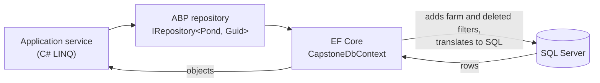

# Database queries

> **Development copy.** Written for release 1.0.0 in `znuluf/try-prod`; this development project works the same way,
> except that its database migrations are generated in each Codespace instead of committed, and read-committed snapshot
> is set by `.devcontainer/start-fpms.sh` rather than by the migration `DatabaseSettings`.

What the system's reads and writes look like, from the C# a developer writes to the SQL that SQL Server runs. Every SQL
example below was **captured from SQL Server 2022** while the application ran (with `ToQueryString()` for reads and
`sys.dm_exec_query_stats` for saves); only long column lists are shortened with `…`.

See also: [How FPMS works](system-overview.md), [API and keys](api-and-keys.md), [Database development](database.md)
(how tables are defined and changed), [Reliability](reliability.md).

---

## 1. Nobody writes SQL by hand (almost)

The code asks for data in C# with **LINQ**; **Entity Framework Core** (EF Core) translates it into SQL, sends it to SQL
Server with parameters, and turns the rows back into objects.



Why this way:

| | |
|---|---|
| **Safe from SQL injection** | Values are always sent as parameters (`@__rid_0`), never pasted into the SQL text. |
| **The farm can never be forgotten** | The farm filter is added by the database layer to every query (section 2). |
| **One source of truth** | Table and column names come from the C# classes; renaming a column is a migration, not a search through SQL strings. |

The only hand-written SQL is four short statements where SQL Server must take a lock or do two things in one step
(section 5).

---

## 2. Two filters added to every query

Every farm table has `TenantId` (the farm) and most have `IsDeleted` (records are voided, never removed). ABP adds both
conditions to **every** query automatically. This is the SQL of the ponds list (`PondAppService.GetAll`):

```csharp
// C# (aspnet-core/src/Capstone.Application/Ponds/PondAppService.cs)
var ponds = await _ponds.GetAll().AsNoTracking()
    .Include(p => p.Prefix)
    .Where(p => includeArchived || !p.IsArchived)
    .OrderBy(p => p.PondCode)
    .ToListAsync();
```

```sql
-- SQL sent to SQL Server
DECLARE @__ef_filter__p_0 bit = CAST(0 AS bit);            -- "soft-delete filter switched off?"  no
DECLARE @__ef_filter__p_2 bit = CAST(0 AS bit);            -- "farm filter switched off?"         no
DECLARE @__ef_filter__CurrentTenantId_1 int = 2;           -- the farm from the sign-in token

SELECT [f].[Id], [f].[AreaM2], [f].[PondCode], [f].[IsArchived], … , [f1].[Name], [f1].[ShortCode], …
FROM [FpmsPonds] AS [f]
INNER JOIN (
    SELECT [f0].[Id], [f0].[Name], [f0].[ShortCode], …
    FROM [FpmsPondNamePrefixes] AS [f0]
    WHERE (@__ef_filter__p_0 = CAST(1 AS bit) OR [f0].[IsDeleted] = CAST(0 AS bit))
      AND (@__ef_filter__p_2 = CAST(1 AS bit) OR [f0].[TenantId] = @__ef_filter__CurrentTenantId_1)
) AS [f1] ON [f].[PrefixId] = [f1].[Id]
WHERE (@__ef_filter__p_0 = CAST(1 AS bit) OR [f].[IsDeleted] = CAST(0 AS bit))
  AND (@__ef_filter__p_2 = CAST(1 AS bit) OR [f].[TenantId] = @__ef_filter__CurrentTenantId_1)
  AND [f].[IsArchived] = CAST(0 AS bit)
ORDER BY [f].[PondCode]
```

Read the `WHERE` as: **not deleted, and belongs to farm 2, and not archived**. The `OR` parts exist so the same plan
works when reviewed System Administrator code switches a filter off; in every farm request both switches are off, so
the condition is simply `IsDeleted = 0 AND TenantId = 2`. The C# never mentions the farm: that is the point. Even the
joined prefix table gets its own farm condition.

Where it comes from: ABP's `AbpDbContext` (base of `CapstoneDbContext`), for every entity that implements
`IMustHaveTenant` and `ISoftDelete` (`FarmEntity` in `Capstone.Core/Domain/FarmEntity.cs`).

---

## 3. Typical reads

### Today's feedings of a batch (the feeding sheet)

```csharp
_sessions.GetAll().AsNoTracking()
    .Where(f => f.BatchId == batchId && f.FeedDate == day)
    .OrderBy(f => f.Session)
```

```sql
DECLARE @__batchId_0 uniqueIdentifier = '52851eb5-db1a-4a72-214e-08df47a3fd7d';
DECLARE @__day_1 date = '2026-11-21';

SELECT [f].[Id], [f].[BatchId], [f].[ClientRequestId], [f].[FedAtTime], [f].[FeedDate], [f].[Session], [f].[Status], …
FROM [FpmsFeedingSessions] AS [f]
WHERE (… not deleted …) AND (… farm 2 …)
  AND [f].[BatchId] = @__batchId_0 AND [f].[FeedDate] = @__day_1
ORDER BY [f].[Session]
```

Fast because of the unique index on `(TenantId, BatchId, FeedDate, Session)`, the same index that allows only one
"Feeding 2" per pond per day.

### Kilograms already sold per harvest grade (checked before every sale)

```csharp
// SaleAppService.SoldByGradeLineAsync
from l in _lines.GetAll()
join s in _sales.GetAll() on l.SaleId equals s.Id
where gradeLineIds.Contains(l.HarvestGradeLineId) && s.Id != exceptSaleId
group l by l.HarvestGradeLineId into g
select new { g.Key, Kg = g.Sum(x => x.Kg) }
```

```sql
DECLARE @__ids_0 nvarchar(4000) = N'["ccc5a14c-af70-4db8-b331-9d3b7a2d4213"]';

SELECT [f].[HarvestGradeLineId] AS [Key], COALESCE(SUM([f].[Kg]), 0.0) AS [Kg]
FROM [FpmsSaleLines] AS [f]
INNER JOIN (
    SELECT [f0].[Id] FROM [FpmsSales] AS [f0]
    WHERE (… not deleted …) AND (… farm 2 …)
) AS [f1] ON [f].[SaleId] = [f1].[Id]
WHERE (… farm 2 …)
  AND [f].[HarvestGradeLineId] IN (SELECT [i].[value] FROM OPENJSON(@__ids_0) WITH ([value] uniqueidentifier '$') AS [i])
GROUP BY [f].[HarvestGradeLineId]
```

The list of IDs travels as one JSON parameter (`OPENJSON`), so the query plan is the same however many grades a sale has.
A voided sale is left out by the `IsDeleted` filter on `FpmsSales`, so its kilograms become sellable again.

### "Was this entry already saved?" (every retry-safe save)

```csharp
_logs.GetAll().AsNoTracking().FirstOrDefaultAsync(l => l.ClientRequestId == input.ClientRequestId)
```

```sql
DECLARE @__rid_0 uniqueIdentifier = 'be340b6f-0e9c-45f0-a756-a59a282d0efc';

SELECT TOP(1) [f].[Id], [f].[BatchId], [f].[ClientRequestId], [f].[LogType], [f].[Notes], [f].[RowVersion], …
FROM [FpmsProductionLogs] AS [f]
WHERE (… not deleted …) AND (… farm 2 …) AND [f].[ClientRequestId] = @__rid_0
```

Served by the unique index on `(TenantId, ClientRequestId)`.

### Figures (FCR, survival, ABW, day of culture)

Figures are never stored. `IndicatorCalculator` (`Capstone.Core/Production/`) works them out from a few small queries:
the batch, its feedings' kilograms (`SUM` over `FpmsStockMovements`), its growth samples and mortality entries, and its
harvests. Reports do the same per batch, limited to 24 months.

---

## 4. What a save looks like

### A new log entry

`LogAppService.Create` adds the log and its details as objects; at the end of the request EF Core sends them in one
batch, inside the request's transaction:

```sql
INSERT INTO [FpmsProductionLogs] ([Id], [BatchId], [ClientRequestId], [CreationTime], [CreatorUserId], …,
    [IsDeleted], [LogType], [Notes], [ObservedAtUtc], [PondId], [TenantId], [VoidReason])
OUTPUT INSERTED.[RowVersion]
VALUES (@p0, @p1, @p2, @p3, @p4, …, @p7, @p10, @p11, @p12, @p13, @p14, @p15);

INSERT INTO [FpmsWaterQualityMeasurements] ([Id], [IsOutOfRange], [LogId], [ParameterCode], [Side], [TenantId], [UnitCode], [Value])
VALUES (@p16, @p17, @p18, @p19, @p20, @p21, @p22, @p23),
       (@p24, @p25, @p26, @p27, @p28, @p29, @p30, @p31),
       (@p32, @p33, @p34, @p35, @p36, @p37, @p38, @p39);
```

- `TenantId`, `CreatorUserId` and `CreationTime` are filled in by ABP from the sign-in, not by the screen.
- `OUTPUT INSERTED.[RowVersion]` returns the version SQL Server stamped, for the next correction's check.
- The water readings go in as one multi-row insert.

### A correction

```sql
UPDATE [FpmsProductionLogs]
SET [LastModificationTime] = @p0, [LastModifierUserId] = @p1, [Notes] = @p2, [ObservedAtUtc] = @p3
OUTPUT INSERTED.[RowVersion]
WHERE [Id] = @p4 AND [RowVersion] = @p5;
```

Only the changed columns are written, and **`AND [RowVersion] = @p5`** is the version the page loaded. If someone saved
the entry in the meantime, no row matches, EF Core notices that zero rows changed, and the person gets "This record was
changed by someone else. Refresh the page and try again." (DEC-133, DEC-134).

### A void

Nothing is deleted. Voiding sets `IsDeleted = 1`, `DeletionTime`, `DeleterUserId` and `VoidReason` with an `UPDATE`
like the one above; feed drawn by a voided feeding is put back with new, reversing rows in `FpmsStockMovements`, so the
stock history is never edited.

---

## 5. The four hand-written statements

Each runs inside the request's transaction and holds its lock until the save ends.

**Lock a row before checking a total** (stocking from a delivery, delivery steps, sales of a harvest;
`Capstone.EntityFrameworkCore/EntityFrameworkCore/Sequences/RowLocker.cs`):

```sql
SELECT Id FROM [FpmsHarvests] WITH (UPDLOCK, ROWLOCK) WHERE Id = @id
```

A second save of the same harvest waits here until the first commits, then sees what it sold.

**One save per request ID at a time** (same file, DEC-134):

```sql
EXEC sp_getapplock @Resource = 'fpms-request:harvest:4c1f…', @LockMode = 'Exclusive',
     @LockOwner = 'Transaction', @LockTimeout = 30000
```

**Take the next number** (cycle codes, receipt numbers, lot codes; `NumberSequenceGenerator.cs`):

```sql
MERGE FpmsNumberSequences WITH (HOLDLOCK) AS t
USING (SELECT @tenantId AS TenantId, @type AS SequenceType, @scope AS Scope) AS s
    ON t.TenantId = s.TenantId AND t.SequenceType = s.SequenceType AND t.Scope = s.Scope
WHEN MATCHED THEN UPDATE SET NextValue = t.NextValue + 1
WHEN NOT MATCHED THEN INSERT (Id, TenantId, SequenceType, Scope, NextValue) VALUES (NEWID(), s.TenantId, s.SequenceType, s.Scope, 2)
OUTPUT ISNULL(deleted.NextValue, 1) AS [Value];
```

Reads and increments in one statement, so two sales at the same moment always get different receipt numbers.

**Database settings** (migration `DatabaseSettings`, once):

```sql
ALTER DATABASE CURRENT SET READ_COMMITTED_SNAPSHOT ON WITH ROLLBACK IMMEDIATE;
ALTER DATABASE CURRENT SET RECOVERY FULL;
```

The first makes reports read the last committed version of a row instead of waiting for a save in progress; every
request reads at READ COMMITTED (DEC-134). The second allows log backups every 30 minutes.

---

## 6. One request, all its queries

What SQL Server sees for one tap of Save on a general note (in order):

| # | Statement | Why |
|---|---|---|
| 1 | `SELECT … FROM AbpUsers …` (at most once a minute per person; remembered in memory between) | Check the person's security stamp (signed out if their password was reset or the account deactivated) |
| 2 | `BEGIN TRANSACTION` (READ COMMITTED) | One save, all or nothing |
| 3 | `EXEC sp_getapplock …` | Wait for a retry of the same entry already in progress |
| 4 | `SELECT TOP(1) … WHERE ClientRequestId = @id` | Already saved? Then return it |
| 5 | `SELECT … FROM FpmsPondBatches … WHERE Id = @batch` | The batch exists in this farm and is open |
| 6 | `INSERT INTO FpmsProductionLogs … OUTPUT INSERTED.RowVersion` | The entry |
| 7 | `INSERT INTO AbpAuditLogs …` | Who called what, when, how long (no request body) |
| 8 | `COMMIT` | |

Permissions are not a query: they are read once into memory and cached.

---

## 7. Indexes: why these queries stay fast

| Index (in `FpmsModelConfiguration.cs`) | Serves |
|---|---|
| Primary key `Id` on every table (sequential GUIDs) | Opening any record |
| `(TenantId, BatchId, FeedDate, Session)` unique, on feedings | The feeding sheet; one feeding per pond, day and number |
| `(TenantId, ClientRequestId)` unique, filtered `IS NOT NULL` | "Already saved?" on every retry-safe table |
| `(TenantId, Status)` on batches and cycles | List filters and status counts |
| `(TenantId, PondId)` unique on batches, filtered to open ones | One open batch per pond; stocking checks |
| `(TenantId, LotId, MovementDateUtc)` and `(TenantId, BatchId)` on stock movements | Stock on hand, feed totals per batch |
| `(TenantId, BatchId, LogType, ObservedAtUtc)` on log entries | Daily record, figures, reports |

At the farm's size (two years of records, about 30,000 log entries) ordinary calls answer in well under half a second;
the load test is in [test-report.md](test-report.md).

---

## 8. Seeing the SQL yourself

| How | What it shows |
|---|---|
| Set the environment variable `Logging__LogLevel__Microsoft.EntityFrameworkCore.Database.Command=Information` (it is `None` in `appsettings.json`) and restart the API | Every statement in the API's log, with its duration. Keep it off on the farm server: it is large. |
| `query.ToQueryString()` on any LINQ query, in a test or the debugger | The SQL of one query, without running it |
| In SQL Server: `SELECT st.text, qs.execution_count, qs.total_elapsed_time FROM sys.dm_exec_query_stats qs CROSS APPLY sys.dm_exec_sql_text(qs.sql_handle) st ORDER BY qs.last_execution_time DESC` | What actually ran recently, how often and how long it took |
| SQL Server Management Studio or Azure Data Studio, connected to the database | Browse tables, run your own `SELECT` (read-only, please) |

Useful read-only queries for checking the data by hand (replace the farm ID):

```sql
-- Farms and their IDs
SELECT Id, TenancyName, Name, IsActive FROM AbpTenants;

-- Open batches of a farm, with their pond
SELECT p.PondCode, b.BatchCode, b.Status, b.StockingDate, b.PlCountStocked
FROM FpmsPondBatches b JOIN FpmsPonds p ON p.Id = b.PondId
WHERE b.TenantId = 2 AND b.IsDeleted = 0 AND b.Status <> 5   -- 5 = Closed
ORDER BY p.PondCode;

-- Feed drawn per batch (kg), from the stock ledger
SELECT b.BatchCode, -SUM(m.Quantity) AS FeedKg     -- usage is stored as a negative quantity
FROM FpmsStockMovements m JOIN FpmsPondBatches b ON b.Id = m.BatchId
WHERE m.TenantId = 2 AND m.IsDeleted = 0 AND m.Type = 2   -- 2 = Usage
GROUP BY b.BatchCode;
```

When you write SQL by hand, add `TenantId = …` and `IsDeleted = 0` yourself: the automatic filters exist only inside
the application.
