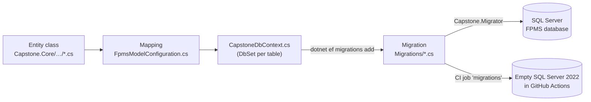
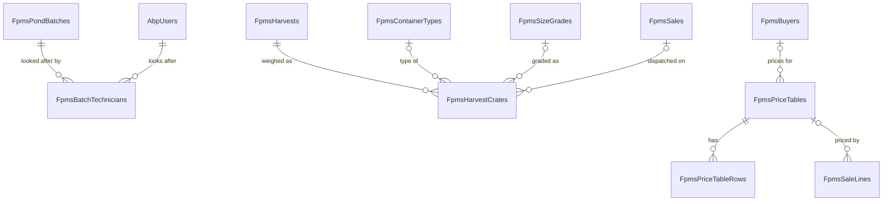

# Database development

How the FPMS database is defined, how a change reaches a farm's SQL Server, and what was added most recently.
Written for developers and for review; the reliability side (retries, version checks, locks) is in
[reliability.md](reliability.md). What the queries themselves look like is in [database-queries.md](database-queries.md); the whole system in [system-overview.md](system-overview.md).

## 1. Where the database comes from

Nobody writes `CREATE TABLE` by hand. The database is **code-first** with Entity Framework Core 9: C# classes
describe the records, and EF Core turns a change in those classes into a reviewed migration script.



| Step | What it holds | File to open |
|---|---|---|
| 1. Entity | The columns, as C# properties. `FarmEntity` adds `Id` (GUID), `TenantId` (the farm), and the audit and soft-delete columns (`CreationTime`, `IsDeleted`, …). `FarmChildEntity` adds only `Id` and `TenantId`, for rows that belong to a parent. | `aspnet-core/src/Capstone.Core/<Area>/*.cs`, base classes in `Capstone.Core/Domain/FarmEntity.cs` |
| 2. Mapping | Table name, text lengths, decimal precision, foreign keys and delete rules, unique and filtered indexes, check constraints. | `aspnet-core/src/Capstone.EntityFrameworkCore/EntityFrameworkCore/FpmsModelConfiguration.cs` |
| 3. Context | One `DbSet<>` per table; makes the entity part of the database. | `aspnet-core/src/Capstone.EntityFrameworkCore/EntityFrameworkCore/CapstoneDbContext.cs` |
| 4. Migration | The generated `Up()` (apply) and `Down()` (undo) for one change, plus a snapshot of the whole model. | `aspnet-core/src/Capstone.EntityFrameworkCore/Migrations/` |
| 5. Apply | Runs every migration the database does not have yet, in order, then seeds reference data and roles. | `aspnet-core/src/Capstone.Migrator/` (`MultiTenantMigrateExecuter.cs`) |
| 6. Check | Builds and tests against the current model. | `.github/workflows/` (this repository generates the migration in CI; the production copy also checks it on SQL Server) |

The table SQL Server keeps of what has been applied is `__EFMigrationsHistory`.

### Migrations in this development repository

This repository does **not** keep its migrations: `aspnet-core/src/Capstone.EntityFrameworkCore/Migrations/` is
git-ignored. `.devcontainer/start-fpms.sh` generates a fresh `Initial` migration from the current model in each
Codespace and rebuilds the database from it, and CI does the same. That keeps development simple while the model
changes often, but it means a database cannot be upgraded in place: after a model change, delete the `Migrations`
folder and drop the database (see the README), and the script recreates both.

The production copy, znuluf/try-prod, commits its migrations (`Initial`, `DatabaseSettings`,
`RetrySafeSavesAndVersions`) so a farm's database is upgraded without losing records (DEC-132). Steps 4 to 8 in
section 3 describe that way of working; here, step 4 is only needed to read the SQL a change would produce.

## 2. What is new since the last diagram

The diagram files `docs/schema.dbml` and `docs/schema.dbdiagram` date from 13 Nov 2026 and show 47 `Fpms*` tables.
The database now has **52**. Nothing was removed except two columns on batches, which moved to the fry delivery.
Each change below names the decision (in `decisions.md`) that explains why it exists.

### New tables

| Table | Columns | Why | Entity |
|---|---|---|---|
| `FpmsBatchTechnicians` | `Id`, `BatchId` → `FpmsPondBatches` (cascade), `UserId` → `AbpUsers`, `TenantId`. Unique on (`BatchId`, `UserId`). | The people who look after a batch, up to 4, as equals (DEC-127). A link table, because one batch can have several technicians and one technician several batches. | `Production/PondBatch.cs` (`BatchTechnician`) |
| `FpmsContainerTypes` | `Name`, `NominalKg`, `TareKg` (empty weight), `SortOrder`, `IsDefault`, `IsActive`, audit columns. | The farm's crate types for the harvest tally (DEC-80). Deactivated, never deleted. | `Harvests/ContainerType.cs` |
| `FpmsHarvestCrates` | `HarvestId` → `FpmsHarvests` (cascade), `CrateNo`, `Kg`, `GrossKg`, `TareKg`, `ContainerTypeId`, `ContainerName` (copy), `SizeGradeId`, `SaleId`. | One row per crate weighed at the harvest (DEC-80); a size grade per crate (DEC-82); which sale took the crate (DEC-86). | `Harvests/HarvestEntities.cs` (`HarvestCrate`) |
| `FpmsPriceTables` | `Name`, `BuyerId` → `FpmsBuyers` (optional), `IsActive`, audit columns. | A buyer's price list by count per kg (DEC-82). | `Sales/SaleEntities.cs` (`PriceTable`) |
| `FpmsPriceTableRows` | `PriceTableId` (cascade), `MinCountPerKg`, `MaxCountPerKg`, `PricePerKg`. | The rows of a price table (DEC-82). | `Sales/SaleEntities.cs` (`PriceTableRow`) |



### New and removed columns on existing tables

| Table | Added | Removed | Why |
|---|---|---|---|
| `FpmsPondBatches` | `CoverUserId`, `CoverUntil` | `TransportMode`, `TimeProcessedUtc` | A cover for a technician's days off (DEC-127). Transport details belong to the delivery, not the batch (DEC-128). |
| `FpmsFryDeliveries` | `PlOrdered`, `ReceivedAtUtc`, `TransportMode`, `TimePackedUtc`; `PlReceived` is now nullable | | The count on the purchase order (DEC-93, named "PL ordered (PO)" in DEC-129). The delivery's steps: an order has no received count yet, and the time received is recorded (DEC-131). Transport moved here (DEC-128). The new status value `Cancelled = 5` is a value, not a column. |
| `FpmsHarvests` | `AbwSamplePieces`, `AbwSampleWeightG` | | The ABW sample on the tally sheet (DEC-80). |
| | `BuyerId`, `WeighedBy` | | The buyer on the harvest and whose scale was used (DEC-81). |
| | `LotCode` | | The harvest lot code for tracing (DEC-83). |
| | `ClientRequestId`, `RowVersion` | | Retry-safe saves and version checks (DEC-133). |
| `FpmsSales` | `ClientRequestId`, `RowVersion` | | Retry-safe saves and version checks (DEC-133). |
| `FpmsSaleLines` | `PriceMethod`, `BaseAbwG`, `BasePricePerKg`, `StepPerG`, `BaseCountPerKg`, `StepPerCount`, `PriceAbwG`, `PriceCountPerKg`, `ReferencePricePerKg`, `PriceTableId`, `PriceTableName`, `PriceTableRowLabel` | | How a line's price per kg was worked out, with its inputs kept (DEC-80, DEC-82). Names are copied so a later edit of the price table never changes a saved sale. |
| `FpmsProductionLogs` | `RowVersion` | | Version check on log entry corrections (DEC-133). |
| `FpmsFarmSettings` | `TimeZone`, `DocumentExpiryAlertDays`, `FarmingSystem`, `DateOrder`, `Use24HourTime`, `FeedingTimes`, `WaterQualityDaily` | | One-to-one operational and display preferences for each farm. The settings row uses the tenant ID as both its primary key and TenantId. |
| `FpmsFarmProfiles` | `TimeZone`, `DocumentExpiryAlertDays`, `FarmingSystem`, `DateOrder`, `Use24HourTime`, `FeedingTimes`, `WaterQualityDaily` | | Legacy copies retained for compatibility with existing farm profile data; new settings reads and writes use `FpmsFarmSettings`. |
| | `UsesSizeGrading` | | Legacy field only; size grading is no longer exposed as a farm preference. |
| | `LotAreaCode`, `LotPlaceCode`, `LotFarmNumber` | | Parts of the harvest lot code (DEC-83). |
| | `RowVersion` | | Version check on farm profile changes (DEC-133). |
| `FpmsPonds` | `IsArchived`, `LengthM`, `WidthM` | | Ponds are archived, never deleted (DEC-77). Length and width are optional (ponds made before they were asked for have only an area); when both are set the area is their product. |
| | `LotNumber` | | The pond's number in the lot code, never reused (DEC-83). |
| `FpmsInventoryItems` | `Code` | | The farm's product code, shown first (DEC-98). |

### The two reliability columns

These appear on several tables and mean the same thing on each:

- **`ClientRequestId`** (`uniqueidentifier`, nullable). The form makes one id per entry and sends it with every
  attempt. A unique index on (`TenantId`, `ClientRequestId`), filtered to rows that have one, lets the database refuse
  a second copy, so a retried save returns the record already saved. On harvests and sales (DEC-133), log entries,
  feedings and pond preparation.
- **`RowVersion`** (`rowversion`). SQL Server changes it on every update. A correction sends the version its page
  loaded; if it no longer matches, someone else saved first and the change is refused. Mapped with `[Timestamp]` on
  the entity. On cycles, batches, deliveries, and since DEC-133 harvests, sales, log entries and the farm profile or settings record.

## 3. How to add or change a column

The worked example is DEC-127, the technicians on a batch.

1. **Change the entity.** Add the property, or a new class for a new table. A farm record derives from `FarmEntity`,
   a child row from `FarmChildEntity`:
   ```csharp
   // Capstone.Core/Production/PondBatch.cs
   public long? CoverUserId { get; set; }
   public DateTime? CoverUntil { get; set; }
   public List<BatchTechnician> Technicians { get; set; } = new();

   public class BatchTechnician : FarmChildEntity
   {
       public Guid BatchId { get; set; }
       public long UserId { get; set; }
   }
   ```
2. **Map it** in `FpmsModelConfiguration.cs`: table name, keys, delete rule, indexes.
   ```csharp
   b.Entity<BatchTechnician>(e =>
   {
       e.ToTable("FpmsBatchTechnicians");
       e.HasOne<PondBatch>().WithMany(x => x.Technicians).HasForeignKey(x => x.BatchId).OnDelete(DeleteBehavior.Cascade);
       e.HasOne<User>().WithMany().HasForeignKey(x => x.UserId).OnDelete(DeleteBehavior.Restrict);
       e.HasIndex(x => new { x.BatchId, x.UserId }).IsUnique();
   });
   ```
3. **Register a new table** with a `DbSet<>` in `CapstoneDbContext.cs` (not needed for a new column).
4. **Generate the migration** from `aspnet-core/` (with the .NET 9 SDK and `dotnet-ef` installed):
   ```bash
   dotnet ef migrations add BatchTechnicians --project src/Capstone.EntityFrameworkCore --startup-project src/Capstone.Web.Host
   ```
   Read the generated `Up()` before committing. It should only add what you meant to add.
   A rename shows as a drop and an add, which loses data, so change it to `RenameColumn`.
5. **Apply it locally** by running the Migrator (`cd src/Capstone.Migrator && dotnet run -- -q`), or let
   `.devcontainer/start-fpms.sh` do it in a Codespace.
6. **See the SQL** if you want to review it as SQL:
   ```bash
   dotnet ef migrations script --idempotent --project src/Capstone.EntityFrameworkCore --startup-project src/Capstone.Web.Host -o migration.sql
   ```
7. **Use it** in the application service (`Capstone.Application/…AppService.cs`) and the DTOs, add a test in
   `aspnet-core/test/Capstone.Tests/`, and record the decision in `decisions.md`.
8. **Commit** the entity and the mapping. In this repository the migration files stay out of git; in the production
   copy they are committed with the change, and CI proves they apply to an empty SQL Server.

### Rules that keep a farm's data safe

- **Never edit or delete a migration that has been released.** A farm's database has already run it. Add a new one.
- **New columns are nullable or have a default**, so the rows already on the farm stay valid. `PlReceived` was made
  nullable rather than given a fake zero.
- **Enums are stored as integers with fixed values** (`Ordered = 1 … Cancelled = 5`). A value is never renumbered or
  reused; a new one is added at the end.
- **Records are soft-deleted** (`IsDeleted`), not removed, and unique indexes on them are filtered to
  `[IsDeleted] = 0`. Production, inventory and money records never cascade-delete. Only pure child rows do
  (technicians on a batch, crates on a harvest, rows of a price table).
- **Every farm table has `TenantId`.** ABP's filter limits every query to the signed-in farm and stamps it on new
  rows; do not set or filter it by hand.
- **Copies, not live links, for anything printed.** A crate keeps the container's name and empty weight, and a sale
  line keeps the price table's name, so editing a setting never changes a saved record.
- **Test against SQL Server, not only the test database.** The automated tests use EF InMemory, which has no row
  versions, check constraints or locks. A Codespace run, and the production copy's CI `migrations` job, cover those.

## 4. Updating the ERD

There are two ways to draw the diagram. Both read the real model, so nothing is drawn by hand.

1. **SchemaSpy (HTML, always current).** In a Codespace with the database migrated (run
   `.devcontainer/start-fpms.sh` first):
   ```bash
   scripts/erd/schemaspy.sh
   ```
   Then open `docs/erd/index.html`. It holds a diagram of all `Fpms*` tables and foreign keys, one diagram per table
   with its neighbours, and every column, index and check constraint. Add `--all` to include ABP's tables. It needs
   Docker.
2. **dbdiagram.io (an image for a report).** `docs/schema.dbml` holds the tables in DBML. Paste it into
   dbdiagram.io, arrange it, and export a PNG or PDF. `docs/schema.dbdiagram` keeps the table positions.
   **Both files are older than the changes in section 2** and must be regenerated before use.

## 5. Where to look, by question

| Question | File |
|---|---|
| What columns does a table have? | The entity in `Capstone.Core/<Area>/`, then its block in `FpmsModelConfiguration.cs` |
| What is the exact SQL type, index or constraint? | `Migrations/CapstoneDbContextModelSnapshot.cs` after a Codespace start (the whole model) |
| When and why was a column added? | The DEC number in `decisions.md`, and `git log` on the entity file |
| Which tables exist? | `CapstoneDbContext.cs` (one `DbSet` per table) |
| How is the database created on the farm PC? | `docs/runbook.md` (install, release and rollback) and `Capstone.Migrator/` |
| What sample data is seeded? | `Capstone.EntityFrameworkCore/EntityFrameworkCore/Seed/Development/SimpleSampleDataBuilder.cs` |
| How are simultaneous saves handled? | `docs/reliability.md` |
