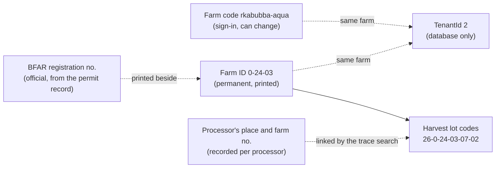

# Proposal: Farm ID

**Status: proposed, not built.** For discussion with the adviser. When it is agreed, it becomes a decision in
[decisions.md](../decisions.md).

A **Farm ID** is one short, permanent number for the farm as a whole: printed on its documents, quoted to processors
and buyers, and the first part of every lot code the farm issues. It uses FPMS's own place list (the one the harvest lot
code already uses, DEC-83), so nothing about existing lot codes changes.

---

## 1. Why the farm needs one

A farm in FPMS is known today by several names, none of which works as a farm ID:

| Today | Example | Why it is not a farm ID |
|---|---|---|
| Farm name | Rkabubba Aqua Farm | Not unique, can be renamed, too long for a label |
| Farm code (sign-in) | `rkabubba-aqua` | Text, made for typing at sign-in; can be changed (DEC-78) |
| Database ID (`TenantId`) | `2` | Internal; means nothing outside this one server |
| BFAR registration number | (from the permit record) | Official and best for regulators, but issued outside FPMS, not always on hand, and in no fixed format |
| Lot identity on Farm profile | area `0`, place `24`, farm `03` | Already exists, but only inside the harvest lot code, never shown or named as the farm's own number |

The last row is the Farm ID already: this proposal gives it a name, a fixed format and a place on every screen and paper
where the farm is identified.

---

## 2. Format: `A-LL-FF`

Five digits, written with hyphens.

| Part | Digits | Meaning | Values |
|---|---|---|---|
| `A` | 1 | **Area** | `0` General Santos City, `1` Sarangani; `2`–`9` free for new areas |
| `LL` | 2 | **Place**: barangay (General Santos) or municipality (Sarangani), from FPMS's list (section 3) | `01`–`26` (General Santos), `01`–`07` (Sarangani) |
| `FF` | 2 | **Farm number** within that place | `01`–`99` |

**Example: `0-24-03`** = General Santos (`0`), Tambler (`24`), the third farm registered there.

```
 0 - 24 - 03
 │   │    └── farm no. 03 in Tambler
 │   └─────── place 24 = Tambler
 └─────────── area 0 = General Santos
```

Read aloud: "General Santos, Tambler, farm three."

It is the middle of the harvest lot code: `26-`**`0-24-03`**`-07-02` is farm `0-24-03`, pond 7, its 2nd harvest of 2026
(see [harvest-lot-code.md](harvest-lot-code.md)).

---

## 3. The place list (`A` and `LL`)

FPMS's own list, in the order of the farm address dropdown, covering every barangay of General Santos City and every
municipality of Sarangani (not only the coastal ones). **Bawing is part of Barangay Siguel**, so it is one place: `22`.

A number never changes meaning. A new place gets the next free number, never a reused one.

**General Santos City barangays (area 0)**

| Code | Barangay | Code | Barangay | Code | Barangay |
|---|---|---|---|---|---|
| 01 | Apopong | 10 | Dadiangas North | 19 | Olympog |
| 02 | Baluan | 11 | Dadiangas South | 20 | San Isidro (Lagao 2nd) |
| 03 | Batomelong | 12 | Dadiangas West | 21 | San Jose |
| 04 | Buayan | 13 | Fatima | 22 | Siguel (Bawing) |
| 05 | Bula | 14 | Katangawan | 23 | Sinawal |
| 06 | Calumpang | 15 | Labangal | 24 | Tambler |
| 07 | City Heights | 16 | Lagao (1st & 3rd) | 25 | Tinagacan |
| 08 | Conel | 17 | Ligaya | 26 | Upper Labay |
| 09 | Dadiangas East | 18 | Mabuhay | | |

**Sarangani municipalities (area 1)**

| Code | Municipality | Code | Municipality |
|---|---|---|---|
| 01 | Alabel | 05 | Maitum |
| 02 | Glan | 06 | Malapatan |
| 03 | Kiamba | 07 | Malungon |
| 04 | Maasim | | |

The place comes from the farm address on Farm profile. In code: `LotPlaces` in
`aspnet-core/src/Capstone.Core/Harvests/HarvestLotCodes.cs`.

---

## 4. Who gives the farm number (`FF`)

**FPMS gives it:** the next free number for that place among all farms in FPMS, the first time the farm needs one (its
first lot code, or when the Owner opens the Farm ID on Farm profile). This is how the lot identity works today.

- **It locks when first used.** Once a lot code, a dispatch receipt or a tally sheet prints the Farm ID, it never
  changes, because paper with it already exists. Moving the farm's address does not change it.
- **It is never reused,** even if the farm closes.
- Only the System Administrator can correct a Farm ID given in error, with a reason; the old one stays searchable.

### The processors' own numbers

Shrimp.io processors (for example ECA Cold Store Plus) number farms their own way: a one-digit coastal place list and a
farm no. each plant assigns. Those are **recorded, not used as the Farm ID**:

| Where | Field | Example |
|---|---|---|
| Buyer (a processor) | Lot code location used by this processor | `0-7` (their Tambler) |
| Buyer (a processor) | Our farm no. at this processor | `07` |

With these, FPMS can show what the processor's lot no. for a harvest should begin with, and the trace search can find a
harvest from the processor's code (see the [lot code proposal](lot-code-alignment-proposal.md)).

---

## 5. Rules

| Rule | Why |
|---|---|
| Unique: no two farms share area, place and number | It identifies one farm |
| Permanent once used; never reused | Old labels and receipts must always point to the same farm |
| Separate from the farm code (sign-in) and the farm name | Those can change; the ID must not |
| Given before the farm's first lot code, not required at registration | A new farm can start recording at once (flag, never block) |
| Only farms in General Santos City or Sarangani get one, until a new area is added to the list | The list defines the places |

---

## 6. Where the Farm ID appears

| Place | Shown as |
|---|---|
| Farm profile | `Farm ID 0-24-03 · General Santos, Tambler`, with a lock notice once used |
| Top bar | Farm name with `0-24-03` under it |
| Tally sheet and dispatch receipt letterhead | `Farm ID 0-24-03`, next to the BFAR registration number when recorded |
| Harvest lot codes | As today: `26-`**`0-24-03`**`-07-02` |
| Trace report and Harvests search | Search by Farm ID, or by any lot code containing it |
| System Administrator's farm list | A column, so support can find a farm by the number on a label |

---

## 7. How it fits with the other identifiers



| Identifier | Who uses it | Changes? |
|---|---|---|
| Farm ID `0-24-03` | People: labels, receipts, buyers, recalls | Never, once used |
| BFAR registration no. | Regulators | When BFAR reissues it |
| Farm code `rkabubba-aqua` | Staff, at sign-in | Rarely (DEC-78) |
| Processor's place and farm no. | That processor's system | As the processor decides |
| `TenantId` | The database | Never; not shown |

---

## 8. What changes in FPMS

Small: the data already exists (`FarmProfile.LotAreaCode`, `LotPlaceCode`, `LotFarmNumber`, unique across farms).

| Area | Change |
|---|---|
| Naming | The lot identity is called **Farm ID** everywhere, formatted `A-LL-FF`. |
| Farm profile | A Farm ID line with the place name; "Give this farm its ID" before the first lot code; lock notice once used. |
| Prints | Tally sheet and dispatch receipt letterheads show the Farm ID. |
| Search | Trace report and Harvests accept a Farm ID. |
| System Administrator | Farm list shows the Farm ID; a correction action with a reason. |
| Setup checklist | No new step: the ID is given with the first lot code, as today. |
| Existing data | Nothing changes: farms that already have a lot identity keep it as their Farm ID. |

About one day. Recording the processors' numbers and linking their codes is the separate
[lot code proposal](lot-code-alignment-proposal.md).

---

## 9. Questions for the adviser

1. Is FPMS's own Farm ID (`A-LL-FF`) right, or should the system wait for an official BFAR farm number and use that?
2. Should the Farm ID print on the dispatch receipt and tally sheet next to the BFAR registration number?
3. Who may correct a Farm ID given in error: only the System Administrator (as proposed), or also the Owner before first
   use?
