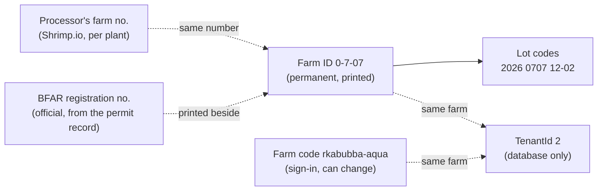

# Proposal: Farm ID

**Status: proposed, not built.** For discussion with the adviser and the Shrimp.io developer. When it is agreed, it
becomes a decision in [decisions.md](../decisions.md).

A **Farm ID** is one short, permanent number for the farm as a whole: printed on its documents, quoted to processors
and buyers, and the first part of every lot code the farm issues. This proposal formats it the same way the Shrimp.io
processors already number farms, so the farm has one number in both systems.

---

## 1. Why the farm needs one

A farm in FPMS is known today by several names, none of which works as a farm ID:

| Today | Example | Why it is not a farm ID |
|---|---|---|
| Farm name | Rkabubba Aqua Farm | Not unique, can be renamed, too long for a label |
| Farm code (sign-in) | `rkabubba-aqua` | Text, made for typing at sign-in; can be changed (DEC-78) |
| Database ID (`TenantId`) | `2` | Internal; means nothing outside this one server |
| BFAR registration number | (from the permit record) | Official and best for regulators, but issued outside FPMS, not always on hand, and in no fixed format |
| Lot identity on Farm profile | area `0`, place `24`, farm `03` | Exists only inside the harvest lot code (DEC-83), numbered differently from the processors |

Meanwhile each Shrimp.io processor gives the farm its own **farm no.** together with its **lot code location** (screenshot
from ECA Cold Store Plus: "Set where this farm is and its farm no."). So the same farm already has a processor's number
that FPMS does not know.

---

## 2. Proposed format: `A-B-FF`

Four digits, written with hyphens for reading and without them inside codes.

| Part | Digits | Meaning | Values |
|---|---|---|---|
| `A` | 1 | **Area** | `0` General Santos City, `1` Sarangani; `2`–`9` free for new areas |
| `B` | 1 | **Place** within the area, from the shared place list (section 3) | `0`–`9` |
| `FF` | 2 | **Farm number** within that place | `01`–`99` |

**Example: `0-7-07`** (in codes: `0707`) = General Santos (`0`), Tambler (`7`), farm 07.

```
 0 - 7 - 07
 │   │   └── farm no. 07 in Tambler
 │   └────── place 7 = Tambler
 └────────── area 0 = General Santos
```

Read aloud: "General Santos, Tambler, farm seven."

These are exactly the `A`, `B` and `FF` digits of the Shrimp.io lot no. (`YYYY A B FF PP`). A processor's lot no. for
this farm therefore always contains `0707`, and FPMS can find the farm from it.

---

## 3. The place list (`A` and `B`)

Shared with Shrimp.io (their `LOT_PLACES`), so both systems give a place the same digits. It only grows: a number, once
given, always names the same place.

| Farm ID starts | Area | Place | | Farm ID starts | Area | Place |
|---|---|---|---|---|---|---|
| `0-0` | General Santos | Baluan | | `1-0` | Sarangani | Alabel |
| `0-1` | General Santos | Bawing | | `1-1` | Sarangani | Glan |
| `0-2` | General Santos | Buayan | | `1-2` | Sarangani | Kiamba |
| `0-3` | General Santos | Bula | | `1-3` | Sarangani | Maasim |
| `0-4` | General Santos | Calumpang | | `1-4` | Sarangani | Maitum |
| `0-5` | General Santos | Labangal | | `1-5` | Sarangani | Malapatan |
| `0-6` | General Santos | Siguel | | | | |
| `0-7` | General Santos | Tambler | | | | |

The Owner picks the place on Farm profile; FPMS suggests it from the farm address.

---

## 4. Who gives the farm number (`FF`)

The farm number must mean the same thing to the farm and to its processors, so it has **one source**:

1. **The processor's number wins.** If a processor has already given the farm a number (as ECA does), the Owner types
   that number on Farm profile. FPMS checks that no other farm in FPMS has the same place and number.
2. **Otherwise FPMS suggests one:** the next free number for that place among the farms in FPMS. The Owner gives it to
   the processor when they first sell, so the processor can use the same number.
3. **It locks when first used.** Once a lot code, a dispatch receipt or a tally sheet prints the Farm ID, it cannot be
   changed, because paper with it already exists. Only the System Administrator can correct it, with a reason, and the
   old ID stays searchable.

If a processor insists on a different number for the farm, that number is kept on the buyer record as "Our farm no. at
this processor", and searches accept both (see the [lot code proposal](lot-code-alignment-proposal.md), section 3.3).

---

## 5. Rules

| Rule | Why |
|---|---|
| Unique: no two farms share area, place and number | It identifies one farm |
| Permanent once used; never reused, even if the farm closes | Old labels and receipts must always point to the same farm |
| Separate from the farm code (sign-in) and the farm name | Those can change; the ID must not |
| Required before the farm's first lot code, not before registration | A new farm can start recording before it has a processor (flag, never block) |
| Farms outside the place list get no Farm ID until the place is added to the shared list | The list must stay the same in both systems |

---

## 6. Where the Farm ID appears

| Place | Shown as |
|---|---|
| Farm profile | `Farm ID 0-7-07` with the place name, and how it was given (from processor / suggested by FPMS) |
| Top bar and sign-in confirmation | Farm name with `0-7-07` under it |
| Tally sheet and dispatch receipt letterhead | `Farm ID 0-7-07`, next to the BFAR registration number when recorded |
| Harvest lot codes | As digits inside the code: `2026` **`0707`** `12-02` (see the [lot code proposal](lot-code-alignment-proposal.md)) |
| Trace report and Harvests search | Search by Farm ID or by any code containing it |
| System Administrator's farm list | A column, so support can find a farm by the number on a label |

---

## 7. How it fits with the other identifiers



| Identifier | Who uses it | Changes? |
|---|---|---|
| Farm ID `0-7-07` | People: labels, receipts, processors, recalls | Never, once used |
| BFAR registration no. | Regulators | When BFAR reissues it |
| Farm code `rkabubba-aqua` | Staff, at sign-in | Rarely (DEC-78) |
| `TenantId` | The database | Never; not shown |

---

## 8. What changes in FPMS

| Area | Change |
|---|---|
| Data | `FarmProfile` already has `LotAreaCode`, `LotPlaceCode`, `LotFarmNumber`: they become the Farm ID, with the Shrimp.io place digits, a "source" (processor / FPMS) and a locked date. A unique index on area, place and number across farms. |
| Farm profile | A Farm ID section: place (suggested from the address), farm number (typed or suggested), lock notice once used. |
| Prints | Tally sheet and dispatch receipt letterheads show the Farm ID. |
| Search | Trace report and Harvests accept a Farm ID or a code containing it. |
| System Administrator | Farm list shows the Farm ID; a correction action with a reason. |
| Setup checklist | "Set the Farm ID" step before the first harvest. |
| Existing data | In development the sample farms get IDs (e.g. Rkabubba Aqua, Tambler: `0-7-01`). A farm already on 1.0.0 keeps its old lot identity for codes already printed, and gets a Farm ID for everything new. |

About one to two days, or three to four together with the [lot code proposal](lot-code-alignment-proposal.md).

---

## 9. Questions before building

**For the Shrimp.io developer**

1. Can the farm give the processor its number (the "suggested by FPMS" case), or does the processor always choose?
2. Is the farm no. the same for a farm at every plant, or can each plant give a different one? (Their screen says
   "They apply to every customer", which suggests one number per farm.)
3. Bawing (`0-1`) and Siguel (`0-6`): as far as we know Bawing is part of Barangay Siguel. Which does a farm there use?
4. The place digit allows 10 places per area and General Santos already uses 8. What happens next?

**For the adviser**

5. Should the Farm ID be ours (`A-B-FF`), or should the system wait for an official BFAR farm number and use that?
6. Should a farm be able to register without a Farm ID (as proposed), or only once it has one?
