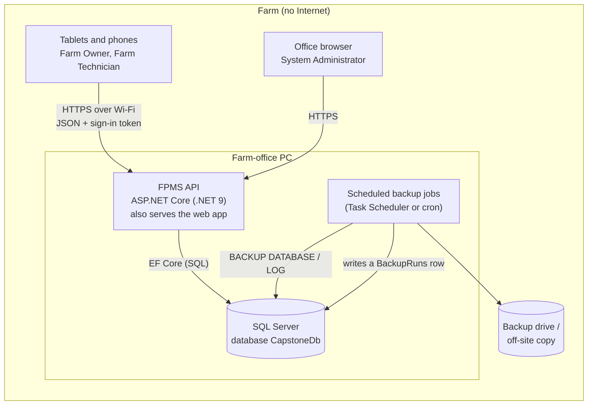
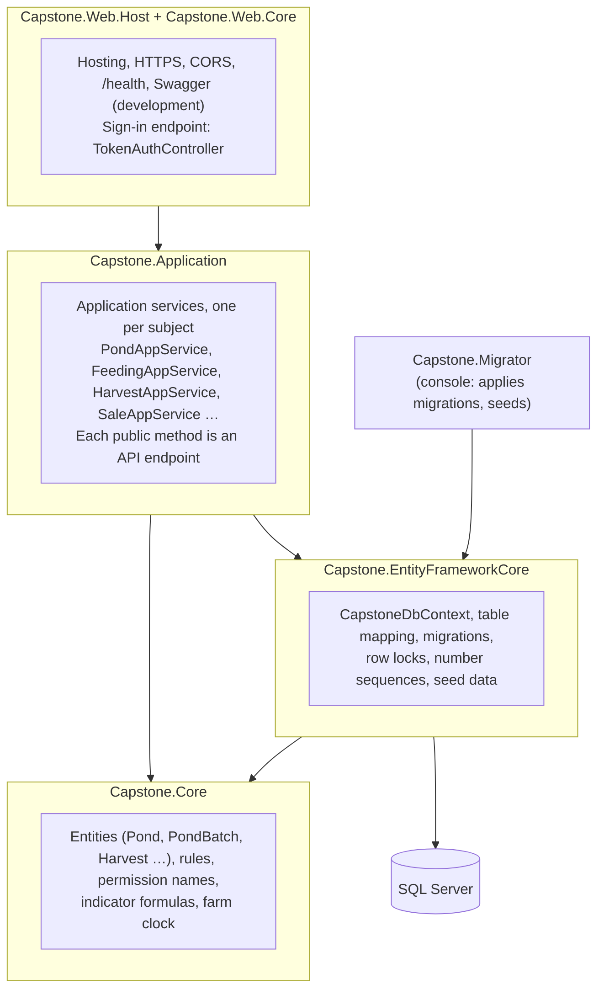
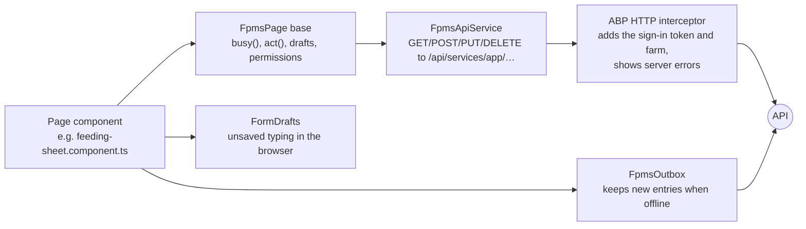
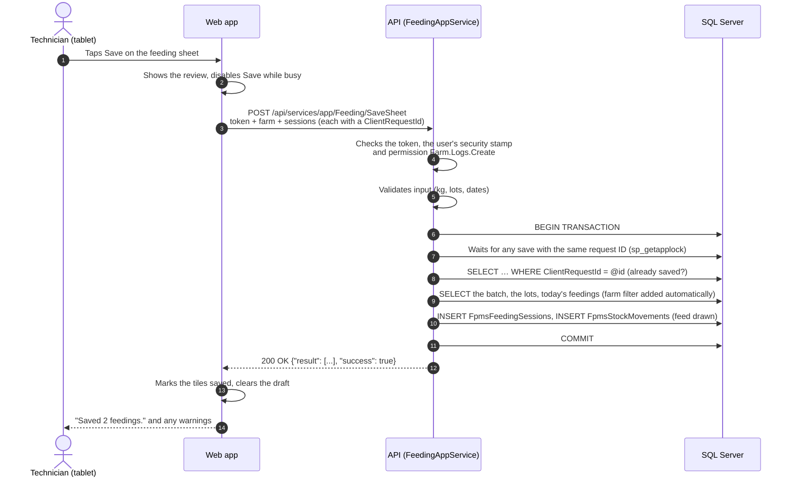
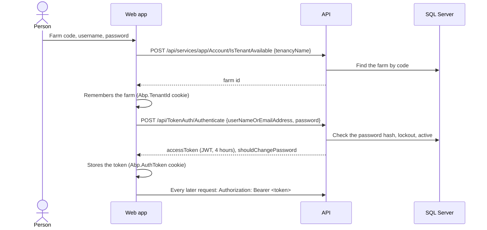
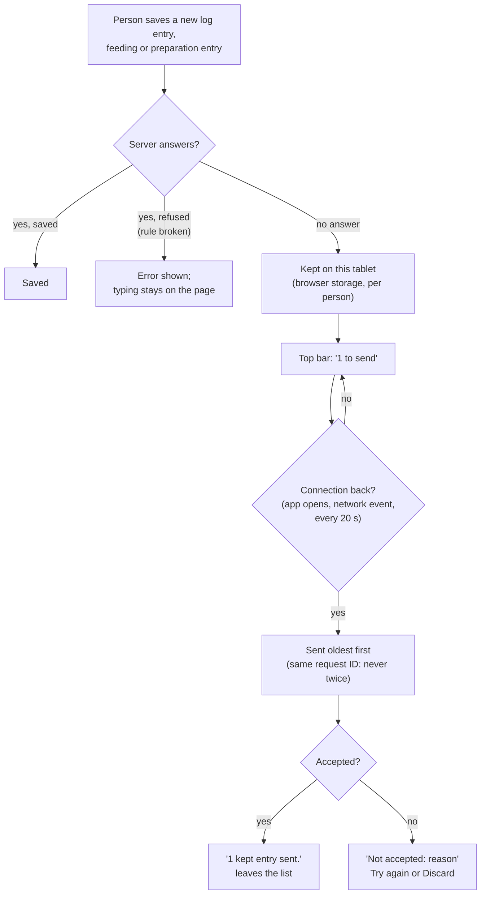
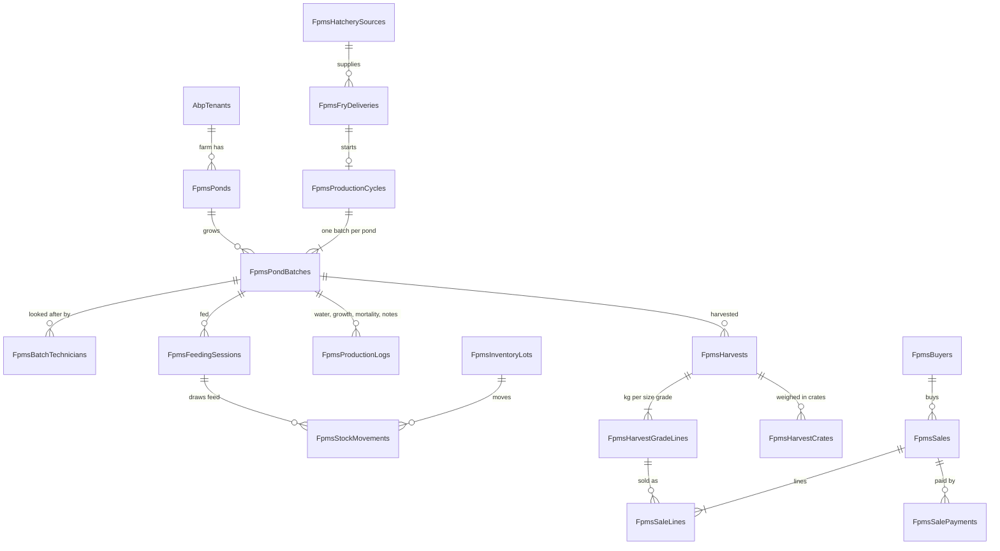

# How FPMS works

> **Development copy.** Written for release 1.0.0 in `znuluf/try-prod`; this development project works the same way,
> except that its database migrations are generated in each Codespace instead of committed, and read-committed snapshot
> is set by `.devcontainer/start-fpms.sh` rather than by the migration `DatabaseSettings`.

A guide to the Farm Production Management System (FPMS) for presenting and understanding it: what the parts are, where
they run, what happens when someone presses Save, and where to look in the code. Diagrams are drawn in Mermaid, which
GitHub shows as pictures.

Related guides:
- [API and keys](api-and-keys.md): every endpoint, how sign-in works, and every secret the system uses.
- [Database queries](database-queries.md): what the reads and writes look like in SQL.
- [Database development](database.md): how the database is defined and changed.
- [Reliability](reliability.md): simultaneous saves, lost connections and failures.

---

## 1. The system in one picture

FPMS is three programs on one farm-office PC, used from tablets and phones over the farm's Wi-Fi. There is no Internet
connection and no outside service: everything the farm needs is on that PC.

| Part | What it is | Where |
|---|---|---|
| **Web app** | An Angular 19 single-page app: the screens people use. Built once into plain files that the API serves. | `angular/` |
| **API** | An ASP.NET Core Web API built on ASP.NET Boilerplate (ABP) 10.2. Holds every business rule, checks every save, and is the only thing that talks to the database. | `aspnet-core/src/` |
| **Database** | SQL Server (Express on the farm PC). One database holds every farm's data, each row tagged with its farm. | Created by `Capstone.Migrator` |
| **Backup jobs** | Shell or PowerShell scripts run by the operating system's scheduler. Not part of the app. | `scripts/backup/` |

---

## 2. Who uses it

| Role | What they do | Sees |
|---|---|---|
| **Farm Technician** | Records the daily work at the ponds: feedings, water quality, growth samples, mortality, pond preparation, harvests, receiving fry | Their farm only; corrects only their own entries |
| **Farm Owner** | Everything a technician does, plus setup, stocking decisions, sales, users, reports and corrections of anyone's entries | Their farm only |
| **System Administrator** | Installs and looks after the server: farms, account recovery, reference data, health and logs | Never sees farm records |

The exact permissions of each role are in [API and keys, section 5](api-and-keys.md#5-roles-and-permissions).

---

## 3. Inside the API: four layers

The API is split into projects that only depend downwards, so the business rules never depend on the web or the database
details.

| Layer | Holds | Example file |
|---|---|---|
| Web | How requests arrive: HTTPS, sign-in, health check | `Capstone.Web.Host/Startup/Startup.cs`, `Capstone.Web.Core/Controllers/TokenAuthController.cs` |
| Application | What each screen can do: list, get, create, update, void; permission checks; input validation | `Capstone.Application/Logbooks/FeedingAppService.cs` |
| Core (domain) | What the farm's records are and the rules that never change with the screen | `Capstone.Core/Production/PondBatch.cs`, `IndicatorCalculator` |
| Data | How records become tables and SQL | `Capstone.EntityFrameworkCore/EntityFrameworkCore/FpmsModelConfiguration.cs` |

ABP turns every public method of an application service into a web endpoint automatically:
`FeedingAppService.SaveSheet` becomes `POST /api/services/app/Feeding/SaveSheet`. There are no hand-written controllers
except sign-in.

## 4. Inside the web app

- **Pages** (`angular/src/app/fpms/…`) are standalone Angular components, one per screen. They extend `FpmsPage`
  (`angular/src/shared/fpms/fpms-page.ts`), which gives every page the API client, the busy flag that stops a double tap,
  permission checks and drafts.
- **The API client** (`angular/src/shared/fpms/api.service.ts`) builds the URL from the service and method names.
- **The interceptor** from `abp-ng2-module` adds `Authorization: Bearer <token>` and the farm to every request, unwraps
  the answer and shows server errors in a dialog.
- **Browser storage** keeps three things, per farm and person: form drafts (24 hours), the outbox of entries kept while
  offline (until sent), and small preferences such as the theme.

---

## 5. What happens when someone presses Save

The example is a technician saving two feedings on the feeding sheet.

What protects the farm's data on the way (details in [reliability.md](reliability.md)):

| Step | Protection |
|---|---|
| 2 | The Save button is disabled while saving, so a double tap cannot send twice. |
| 3 | Each new entry carries a request ID; a retry returns the record already saved. |
| 4 | Only a signed-in person with the right permission gets through; a deactivated account is signed out within a minute. |
| 5 | Every value is checked again on the server; the screen's checks are only a convenience. |
| 6–10 | One transaction: all of it is saved or none of it. Two saves of the same thing wait for each other. |
| 8 | Every query is limited to the signed-in person's farm and skips deleted rows, without the code asking for it. |

If the Wi-Fi drops at step 3, the entry is kept on the tablet and sent later (section 7).

---

## 6. Signing in

The token is signed with the server's secret signing key, so it cannot be forged or changed. It carries who the person
is and which farm they belong to; the farm is never taken from what the screen sends. Full detail in
[API and keys](api-and-keys.md#2-signing-in-and-the-access-token).

---

## 7. Working without a connection

Corrections, harvests and sales are not kept offline: they need the server's current version, or give a lot code or
receipt number to hand over on the spot. DEC-135.

---

## 8. The data, in one picture

The database has 52 farm tables (`Fpms…`) plus ABP's own (`Abp…`: farms, users, roles, audit log). The core of the
farm's records:

The life of a crop, in the order the farm works:

1. **Ponds** are prepared (`FpmsPondPreparationRounds`, `…Entries`) until they are Prepared.
2. **Fry are delivered** (`FpmsFryDeliveries`): ordered, in transit, received at the gate, with each step in
   `FpmsFryDeliveryStatusChanges`.
3. **Stocking** starts a **production cycle** (`FpmsProductionCycles`) and one **batch** per pond (`FpmsPondBatches`).
4. Every day the batch gets **feedings** (`FpmsFeedingSessions`, drawing feed from `FpmsInventoryLots` through
   `FpmsStockMovements`) and **log entries** (`FpmsProductionLogs` with details such as `FpmsWaterQualityMeasurements`).
5. **Harvests** (`FpmsHarvests`) record kilograms per size grade (`FpmsHarvestGradeLines`) and get a lot code.
6. **Sales** (`FpmsSales`, `FpmsSaleLines`) sell those grade lines to buyers, with payments.
7. The batch and the cycle are **closed**; their records become read-only.

Figures such as FCR, survival, day of culture or pond status are **worked out when read**, never stored, so they can
never disagree with the records. The full list of tables and columns is in [database.md](database.md) and the schema
files `docs/schema.dbml` (dbdiagram.io).

---

## 9. Where it runs

| | Development | Production (farm PC) |
|---|---|---|
| Where | GitHub Codespace or a dev container | The farm-office PC (Windows or Ubuntu) |
| Database | SQL Server 2022 in Docker, `FPMS_Simple` (sample farm) or `FPMS` | SQL Server Express, `CapstoneDb` |
| Started by | `bash .devcontainer/start-fpms.sh` | The API as a service; `Capstone.Migrator` on install and upgrade |
| Web app | `ng serve` on port 4200 | Built files served by the API |
| Secrets | Generated into `.devcontainer/local.env` | Environment variables on the PC (see [API and keys](api-and-keys.md#6-keys-and-secrets)) |
| Swagger (API explorer) | On, `/swagger` | Off |

Day-to-day operation (backups, certificate renewal, alerts, release and rollback) is in [runbook.md](runbook.md).

---

## 10. Words used in this project

| Word | Meaning |
|---|---|
| Farm / tenant | One farm. ABP calls it a tenant; every farm row has `TenantId`. |
| Farm code | The short name typed at sign-in to pick the farm (`TenancyName`). |
| Cycle | One stocking of one fry delivery into one or more ponds. |
| Batch | One pond's share of a cycle, from stocking to closing. |
| ABW, FCR, DOC | Average body weight, feed conversion ratio, day of culture. |
| Request ID | A random ID a form makes for a new entry, so sending it twice never saves it twice. |
| Row version | A number SQL Server changes on every update, so a stale correction is refused. |
| DEC-nn | A recorded decision in `decisions.md`. |
